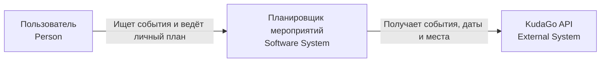
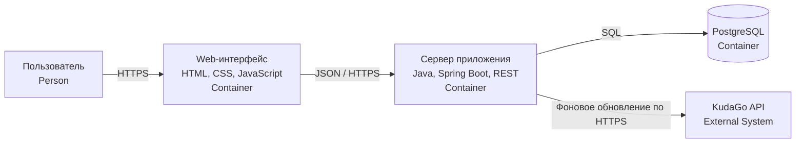
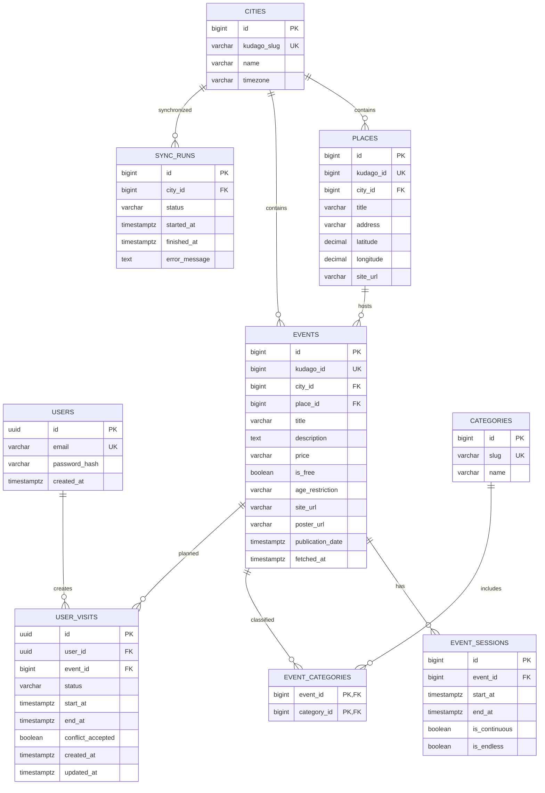

# kpo-event-planner

Разработка веб-приложения для формирования персонального расписания городских мероприятий.

Учебный проект по дисциплине «Конструирование программного обеспечения».

## Текущее состояние — 21 октября 2026 года

Первые три этапа сданы, по сообщению автора. Подготовлен каркас приложения: Spring Boot, миграции девяти таблиц, API городов, стартовая страница и логирование. Это ещё не MVP: импорт KudaGo, поиск событий, вход, личный план и проверка пересечений не реализованы.

Конфигурация: Java 17, Spring Boot 3.5.16, Maven 3.9.11, PostgreSQL 17.

### Запуск одной командой

Нужны Docker, Compose v2 и Bash (Windows: WSL или Git Bash).

```bash
bash scripts/run.sh
```

Скрипт создаёт локальный .env из .env.example, собирает проект, запускает тесты с отдельной временной БД, затем поднимает приложение и основную БД. Миграции применяются Flyway при старте. При первой сборке нужен интернет для загрузки зависимостей и образов.

- Приложение: http://localhost:8080
- API городов: http://localhost:8080/api/cities
- Проверка состояния: http://localhost:8080/actuator/health
- Отчёты: test-reports/
- Основная БД: localhost:5433, база event_planner, пользователь planner.
- Пароль задаётся в .env; пример предназначен для локальной разработки.
- APP_PORT и DB_PORT в .env позволяют менять порты.
- Остановка: `docker compose down`. Основные данные сохраняются в volume. Ключ -v удаляет их.
- Полный запуск Docker пока не проверен в среде подготовки.

### Разработка и тесты

`mvn test` выполняет модульные тесты, `mvn package` собирает JAR. Запущенная БД для этих команд не нужна.

Для приложения запустите PostgreSQL и задайте переменные среды DB_URL=jdbc:postgresql://localhost:5433/event_planner, DB_USER=planner и DB_PASSWORD. Затем выполните `mvn spring-boot:run` или запустите основной класс в IDE. Maven и IDE автоматически .env не читают.

Для интеграционных тестов создайте .env из примера, если его ещё нет:

```bash
docker compose --profile test up -d db-test
# Дождитесь готовности базы.
mvn verify
docker compose --profile test rm -sf db-test
```

Тестовый профиль использует localhost:15432 и отдельную БД event_planner_test. Переопределение: TEST_DATABASE_URL, TEST_DATABASE_USER, TEST_DATABASE_PASSWORD. Не направляйте тесты в основную БД.

CI настроен на `mvn verify` при push и pull request, но ещё не опубликован и не выполнен в GitHub. Следующие изменения схемы добавляйте миграциями V3 и далее; применённые миграции не редактируйте.

[Выполненная работа](docs/WORK_DONE.md) · [Следующие задачи](docs/NEXT_STEPS.md).

Ниже — проектная документация этапов 1–3. Она описывает целевую систему; текущая реализация перечислена выше.

---

## Участник и технологии

| Параметр | Значение |
| --- | --- |
| Исполнитель | **Требуется указать корректное ФИО** |
| Группа | **Требуется указать корректную группу** |
| Формат выполнения | Индивидуальный |
| Серверная часть | Java, Spring Boot |
| Клиентская часть | HTML, CSS, JavaScript |
| База данных | PostgreSQL |
| Внешний источник | KudaGo API |
| Репозиторий | https://github.com/Daniil-drom/kpo-event-planner |

Подготовлены Maven, JUnit, тесты каркаса, Docker Compose и GitHub Actions. Статус проверки описан в docs/WORK_DONE.md.

В этом README оформлены этапы 1–3. Тема и выбранный стек подтверждены преподавателем. Реализация приложения, тесты и контейнеризация относятся к следующим этапам.

## Этап 1. Определение проблемы и формулировка темы

### Проблема

При планировании посещения городских мероприятий пользователю приходится самостоятельно сопоставлять даты и время выбранных событий, сохранять сведения о них и поддерживать актуальный список планов. Из-за этого можно потерять интересующее мероприятие или запланировать несколько посещений на одно время.

### Тема проекта

«Разработка веб-приложения для формирования персонального расписания городских мероприятий».

### Целевая аудитория и цель

Целевая аудитория — пользователи, которые выбирают мероприятия в Санкт-Петербурге, Москве и Екатеринбурге и планируют их посещение.

Цель проекта — предоставить пользователю каталог мероприятий и личный план посещений с предупреждениями о пересечениях по времени. KudaGo предоставляет сведения о событиях; пользовательские планы и проверка расписания реализуются в нашем приложении.

Тема и стек подтверждены преподавателем.

## Этап 2. Выработка требований

### 2.1. Границы продукта

Веб-приложение включает:

- просмотр каталога с постраничной выдачей;
- каталог для Санкт-Петербурга, Москвы и Екатеринбурга;
- фильтрацию по одному из поддерживаемых городов, периоду, категории и признаку бесплатного события;
- карточку с названием, описанием, местом, датами, стоимостью при наличии и ссылкой на KudaGo;
- регистрацию, вход и выход пользователя;
- добавление посещений в личный план, изменение времени, статуса и удаление;
- статусы «Хочу посетить», «Запланировано», «Посещено»;
- предупреждения о пересечениях запланированных посещений;
- просмотр сохранённого каталога при временной недоступности KudaGo.

В первую версию не входят карты и маршрутизация, покупка билетов, совместные планы, уведомления, автоматические рекомендации, оптимизация расписания и дополнительные источники мероприятий. Числовой фильтр по бюджету не предусмотрен: стоимость показывается в виде, предоставленном источником. Интерфейс личного плана представляет собой список посещений с датами.

### 2.2. Пользовательские истории и критерии приёмки

#### US-1. Найти подходящее мероприятие

Как пользователь, я хочу отбирать мероприятия по городу, периоду и категории, чтобы найти подходящее событие.

Критерии приёмки:

1. Каталог можно просматривать без входа; сохранение личного плана требует входа.
2. Установленные фильтры применяются совместно. Есть переключатель «Только бесплатные» и возможность сброса фильтров.
3. Для периода подходят события, у которых хотя бы один известный сеанс или период проведения пересекается с выбранным периодом. Если определить даты невозможно, событие не включается в результат фильтра по датам.
4. Если совпадений нет, отображается сообщение об отсутствии мероприятий. При большом количестве результатов доступна постраничная выдача.
5. Из списка открывается карточка события с прямой ссылкой на его страницу KudaGo. Для отсутствующей цены или места отображается «Не указано», а не придуманное значение.

#### US-2. Составить личный план

Как пользователь, я хочу сохранять выбранные посещения и управлять ими, чтобы видеть своё расписание и историю планов.

Критерии приёмки:

1. Пользователь может зарегистрироваться, войти и выйти. После входа ему доступны только его записи плана.
2. Событие можно сохранить со статусом «Хочу посетить» без времени посещения.
3. При переводе в «Запланировано» пользователь выбирает конкретный сеанс или задаёт начало и окончание посещения. Окончание должно быть позже начала.
4. Сохранённые записи доступны после обновления страницы и повторного входа. Пользователь может изменить время, статус или удалить запись.
5. «Посещено» устанавливается самим пользователем. Прошедшие записи сохраняются в истории и не считаются посещёнными автоматически.

#### US-3. Проверить пересечения в расписании

Как пользователь, я хочу получать предупреждение о пересечениях посещений, чтобы скорректировать личный план.

Критерии приёмки:

1. Проверка выполняется при добавлении запланированного посещения, изменении его времени или переводе в статус «Запланировано».
2. Сравниваются только запланированные интервалы этого пользователя. При редактировании запись не сравнивается сама с собой.
3. Пересечение существует, если `начало_A < окончание_B` и `начало_B < окончание_A`.
4. При конфликте интерфейс показывает названия и время пересекающихся посещений. Пользователь может исправить время или явно подтвердить сохранение с конфликтом.
5. Если одно посещение заканчивается ровно в момент начала другого, конфликта нет. Время дороги в первой версии не учитывается.

### 2.3. Правила работы с датами и данными

- Мероприятие и посещение — разные сущности: мероприятие может длиться месяц, а посещение занимает выбранный пользователем интервал.
- При нескольких сеансах пользователь выбирает нужный. Если точное окончание отсутствует, пользователь указывает его самостоятельно; приложение не считает неизвестный интервал проверенным.
- Время вводится и отображается с указанием часового пояса города; для сравнения используется единая временная шкала.
- Обновление каталога не меняет выбранное пользователем время посещения без его действия. В карточке показываются доступные сведения источника и время последнего успешного обновления.
- Отсутствие события в очередной выдаче не считается подтверждением отмены. Оно не приводит к автоматическому удалению пользовательского плана.
- Для доступных через приложение заимствованных материалов сохраняется ссылка на конкретный первоисточник (`site_url`); опубликованные ссылки не закрываются атрибутами `nofollow` или `noindex`.

### 2.4. Масштаб системы

Базовый расчётный масштаб — **10 000 уникальных пользователей в сутки**.

Допущения для первоначальной оценки:

| Показатель | Принятое значение |
| --- | ---: |
| Чтения каталога, карточек и плана на пользователя в сутки | 20 |
| Изменения личного плана на пользователя в сутки | 2 |
| Чтения за сутки | 200 000 |
| Изменения за сутки | 20 000 |
| Всего запросов указанных видов за сутки | 220 000 |
| Средняя частота | 220 000 / 86 400 ≈ 2,55 запроса/с |
| Принятый коэффициент пикового спроса | 10 |
| Первоначальный ориентир пика | Около 26 запросов/с |

Это допущения для проектирования, а не результаты нагрузочного теста. Уникальные пользователи в сутки не равны одновременным подключениям. Оценка не включает загрузку статических файлов, операции входа и фоновые запросы к KudaGo; их вклад уточняется в этапе 3 вместе с Read/Write, трафиком и дисковым пространством.

Пользовательские запросы обслуживаются по сохранённым данным. Число обращений к KudaGo определяется обновлением каталога и его объёмом, а не количеством просмотров страниц.

### 2.5. Поведение при недоступности KudaGo

Выбранный подход — сохранение каталога в PostgreSQL и временное ограничение функций, зависящих от свежих данных источника. Персональные планы хранятся независимо от доступности API.

| Ситуация | Требуемое поведение |
| --- | --- |
| API доступен | Сервер обновляет каталог и фиксирует время успешного обновления |
| API недоступен, каталог уже загружался | Показывается сохранённый каталог, сообщение об устаревании и время обновления; доступны операции личного плана |
| API недоступен, каталог ещё не загружался | Показывается сообщение о временной недоступности каталога; приложение не выдаёт это за отсутствие мероприятий в городе |
| Обновление прервалось | Ранее сохранённые данные и пользовательские планы не очищаются; частичная загрузка не помечается как полностью успешная |
| Источник снова доступен | Обновление возобновляется; сообщение об устаревании снимается после успешной загрузки соответствующих данных |

Начальные параметры, которые подлежат реализации и проверке:

- плановое обновление каталога — раз в час; одновременно выполняется один цикл обновления;
- один HTTP-запрос ограничен общим тайм-аутом 15 секунд;
- при сетевой ошибке или HTTP 5xx допускается одна повторная попытка через 30 секунд; после повторного сбоя цикл прекращается до следующего планового запуска;
- при HTTP 429 учитывается `Retry-After`, если он есть; иначе обращения откладываются до следующего планового цикла;
- при остальных HTTP 4xx автоматические повторы того же запроса не выполняются; ошибка фиксируется для разбора;
- страницы выдачи загружаются последовательно; между запросами выдерживается пауза не менее секунды, пропущенные циклы не накапливаются.

Эти значения — настройки нашего проекта, а не опубликованные квоты KudaGo. При наличии `Retry-After` пауза сервера имеет приоритет над расписанием обновления. Интервал между полными обновлениями уточняется с учётом размера каталога и фактической доступности источника.

### 2.6. Остальные нефункциональные требования

- Данные пользователей и посещений сохраняются в PostgreSQL и переживают обычный перезапуск приложения.
- Пароли хранятся в виде стойких хешей. Доступ к каждой записи плана проверяется на сервере по текущему пользователю.
- Проектный ориентир: 95% запросов к сохранённому каталогу и личному плану обрабатываются сервером не дольше одной секунды при принятой базовой нагрузке. Среда измерения и окончательные показатели уточняются в этапе 3.
- Ошибки внешнего API не завершают работу приложения. В логах фиксируются результаты и длительность запросов без паролей и содержимого сессий.

### 2.7. Результат этапов 1–2

Определены проблема, тема, аудитория, границы продукта, три пользовательские истории с критериями приёмки, исходный масштаб и поведение при недоступности внешнего API. Выполнение этих требований кодом проверяется на следующих этапах.

Следующий раздел содержит архитектуру и детальное проектирование: C4 Context/Container, контракты API, ER-диаграмму и индексы, расчёты Read/Write и трафика, хранение более пяти лет и стратегию масштабирования до 100 000 пользователей в сутки.

## Этап 3. Разработка архитектуры и детальное проектирование

### 3.1. Архитектурный подход

Для первой версии выбран **модульный монолит**. Один сервер Spring Boot предоставляет REST API, выполняет бизнес-логику и раздаёт статические файлы HTML, CSS и JavaScript. Каталог мероприятий, пользователи и личные планы хранятся в PostgreSQL. Фоновый планировщик внутри приложения последовательно обновляет каталог из KudaGo.

Такой вариант соответствует текущей нагрузке, проще в разработке и развёртывании, чем набор микросервисов, и не мешает горизонтальному масштабированию серверной части в дальнейшем.

Поддерживаемые города первой версии:

| Город | Идентификатор KudaGo | Часовой пояс |
| --- | --- | --- |
| Санкт-Петербург | `spb` | UTC+3 |
| Москва | `msk` | UTC+3 |
| Екатеринбург | `ekb` | UTC+5 |

В базе время хранится в UTC в полях типа `timestamptz`. При отображении применяется часовой пояс города мероприятия.

### 3.2. Расчёт нагрузки

Исходные значения из этапа 2:

- 10 000 уникальных пользователей в сутки;
- 20 операций чтения на пользователя в сутки;
- 2 операции изменения личного плана на пользователя в сутки;
- коэффициент пикового спроса — 10.

#### Read/Write

| Показатель | Расчёт | Результат |
| --- | ---: | ---: |
| Чтения в сутки | 10 000 × 20 | 200 000 |
| Записи в сутки | 10 000 × 2 | 20 000 |
| Все операции в сутки | 200 000 + 20 000 | 220 000 |
| Read/Write | 200 000 : 20 000 | 10 : 1 |
| Доля чтений | 200 000 / 220 000 | 90,9% |
| Доля записей | 20 000 / 220 000 | 9,1% |
| Средняя нагрузка | 220 000 / 86 400 | 2,55 запроса/с |
| Пиковая нагрузка | 2,55 × 10 | около 26 запросов/с |

В расчётной точке пика получается около 23 запросов чтения и 3 запросов записи в секунду. Для одного экземпляра Spring Boot и PostgreSQL это небольшая нагрузка, но приложение проектируется без хранения пользовательской сессии в памяти бизнес-модулей, чтобы позднее можно было добавить серверные реплики.

#### Сетевой трафик

Для расчёта приняты следующие значения:

- запрос чтения — в среднем 1 КБ;
- ответ на чтение — в среднем 25 КБ;
- запрос изменения — в среднем 2 КБ;
- ответ на изменение — в среднем 2 КБ;
- изображения не передаются через наш сервер: в базе хранится URL изображения KudaGo.

| Трафик | Расчёт | Результат |
| --- | ---: | ---: |
| Чтения в сутки | 200 000 × (1 + 25) КБ | 5,20 ГБ |
| Записи в сутки | 20 000 × (2 + 2) КБ | 0,08 ГБ |
| Всего в сутки | 5,20 + 0,08 | 5,28 ГБ |
| Всего за год | 5,28 × 365 | около 1,93 ТБ |
| Всего за 6 лет | 1,93 × 6 | около 11,56 ТБ |

Пиковая передача динамических данных составляет примерно 0,61 МБ/с, или 4,9 Мбит/с. С двукратным запасом для базовой системы достаточно канала 10 Мбит/с без учёта загрузки статических файлов и служебного трафика.

#### Дисковое пространство на 6 лет (> 5 лет)

Расчёт является оценкой для проектирования. Принимается не более одной новой записи посещения на активного пользователя в сутки; изменение существующего посещения обновляет запись, а не создаёт отдельную копию каждого изменения.

Верхняя оценка числа новых событий взята из справки KudaGo: портал добавляет 3–5 тысяч событий в месяц. Для расчёта используется верхняя граница — 5 000 событий в месяц, то есть до 360 000 событий за шесть лет. Для каждого события закладывается в среднем пять сеансов и три категории.

| Данные | Допущение | Объём |
| --- | --- | ---: |
| События | до 360 000 × 5 КБ | 1,80 ГБ |
| Сеансы событий | до 1 800 000 × 160 Б | 0,29 ГБ |
| Связи событий и категорий | до 1 080 000 × 64 Б | 0,07 ГБ |
| Места | до 36 000 × 1 КБ | 0,04 ГБ |
| Пользователи | до 600 000 × 0,5 КБ | 0,30 ГБ |
| Посещения | 10 000 × 365 × 6 × 0,5 КБ | 10,95 ГБ |
| Журнал синхронизации | 24 × 365 × 6 × 0,5 КБ | менее 0,03 ГБ |
| Итого данных без индексов | сумма строк | около 13,47 ГБ |

Индексы, служебные данные PostgreSQL и запас на разрастание увеличивают расчётный объём примерно до 30 ГБ. Для основной базы выделяется **50 ГБ**, а вместе с резервными копиями и запасом — не менее **100 ГБ** дискового пространства.

### 3.3. C4: контекст системы



Пользователь работает только с нашим приложением. Прямые обращения браузера к API KudaGo не выполняются. Ссылка на конкретную страницу первоисточника сохраняется и показывается в карточке мероприятия.

### 3.4. C4: контейнеры системы



| Контейнер | Ответственность |
| --- | --- |
| Web-интерфейс | Каталог, фильтры, карточка события, формы входа и личный план |
| Spring Boot | REST API, авторизация, бизнес-правила, проверка пересечений и синхронизация KudaGo |
| PostgreSQL | Пользователи, события, сеансы, категории, места, личные планы и результаты синхронизации |

### 3.5. Контракт с KudaGo

Для импорта используется запрос списка событий API v1.4:

```text
GET https://kudago.com/public-api/v1.4/events/
```

Основные параметры:

| Параметр | Значение проекта |
| --- | --- |
| `location` | `spb`, `msk` или `ekb` |
| `actual_since` | начало загружаемого периода в UTC |
| `actual_until` | конец загружаемого периода в UTC |
| `page` | номер страницы |
| `page_size` | 100 |
| `text_format` | `plain` |
| `fields` | `id,publication_date,dates,title,slug,place,description,location,categories,age_restriction,price,is_free,images,site_url` |
| `expand` | `dates,place,location,images` |

Каталог каждого города обновляется последовательно. Полный цикл запускается раз в час, одновременно выполняется только один цикл. Событие идентифицируется по `kudago_id`, поэтому повторная загрузка обновляет существующую запись, а не создаёт дубликат.

### 3.6. Внутренний REST API

| Метод и путь | Назначение | Доступ | Успешный ответ |
| --- | --- | --- | --- |
| `POST /api/auth/register` | Регистрация | Все | `201 Created` |
| `POST /api/auth/login` | Вход и создание сессии | Все | `200 OK` |
| `POST /api/auth/logout` | Завершение сессии | Пользователь | `204 No Content` |
| `GET /api/auth/me` | Текущий пользователь | Пользователь | `200 OK` |
| `GET /api/cities` | Поддерживаемые города | Все | `200 OK` |
| `GET /api/categories` | Категории событий | Все | `200 OK` |
| `GET /api/events` | Каталог с фильтрами и пагинацией | Все | `200 OK` |
| `GET /api/events/{id}` | Карточка мероприятия | Все | `200 OK` |
| `GET /api/visits` | Личный план пользователя | Пользователь | `200 OK` |
| `POST /api/visits` | Добавление посещения | Пользователь | `201 Created` |
| `PATCH /api/visits/{id}` | Время или статус посещения | Владелец записи | `200 OK` |
| `DELETE /api/visits/{id}` | Удаление посещения | Владелец записи | `204 No Content` |

Параметры `GET /api/events`: `city`, `dateFrom`, `dateTo`, `category`, `free`, `page`, `size`. Размер страницы ограничивается сервером. Для ошибок используются стандартные статусы `400`, `401`, `403`, `404` и `409`. Статус `409 Conflict` возвращается при пересечении посещений вместе со сведениями о конфликтующих интервалах; пользователь может повторить запрос с явным подтверждением конфликта.

Основные структуры JSON:

| Контракт | Поля |
| --- | --- |
| `RegisterRequest` | `email`, `password` |
| `LoginRequest` | `email`, `password` |
| `UserResponse` | `id`, `email` |
| `EventSummaryResponse` | `id`, `title`, `city`, `place`, `nextSession`, `price`, `isFree`, `posterUrl` |
| `EventResponse` | поля списка, а также `description`, `ageRestriction`, `siteUrl`, `sessions`, `fetchedAt` |
| `PageResponse<EventSummaryResponse>` | `items`, `page`, `size`, `totalItems`, `totalPages` |
| `VisitCreateRequest` | `eventId`, `status`, `startAt`, `endAt`, `acceptConflict` |
| `VisitUpdateRequest` | изменяемые `status`, `startAt`, `endAt`, `acceptConflict` |
| `VisitResponse` | `id`, `event`, `status`, `startAt`, `endAt`, `conflictAccepted`, `createdAt`, `updatedAt` |
| `ApiError` | `code`, `message`, `fieldErrors`, `conflicts`, `requestId` |

Поля `startAt` и `endAt` передаются в ISO 8601 со смещением часового пояса. Для статуса `PLANNED` оба поля обязательны и `endAt` должно быть позже `startAt`; для `WANT_TO_VISIT` время может отсутствовать. Ответ на успешный вход устанавливает cookie сессии с атрибутами `HttpOnly`, `Secure` и `SameSite=Lax`. Пароль и идентификатор сессии не возвращаются в JSON.

Целевые значения времени ответа при базовой нагрузке:

| Операция | Требование |
| --- | --- |
| Каталог и карточка события | p95 ≤ 1 с |
| Чтение личного плана | p95 ≤ 1 с |
| Создание и изменение посещения | p95 ≤ 1 с |
| Регистрация и вход | p95 ≤ 1,5 с с учётом выбранной стоимости хеширования пароля |
| Фоновый запрос KudaGo | общий тайм-аут 15 с; не входит в пользовательский запрос |

### 3.7. Проектирование базы данных



Основные индексы:

| Таблица | Индекс | Причина |
| --- | --- | --- |
| `users` | `UNIQUE (email)` | Вход и запрет дублирующихся учётных записей |
| `cities` | `UNIQUE (kudago_slug)` | Поиск города по идентификатору API |
| `places` | `UNIQUE (kudago_id)` | Обновление места без дубликатов |
| `events` | `UNIQUE (kudago_id)` | Идемпотентная синхронизация |
| `events` | `(city_id, is_free, publication_date DESC)` | Базовые фильтры каталога |
| `event_sessions` | `(start_at, end_at, event_id)` | Отбор мероприятий по периоду |
| `event_categories` | `(category_id, event_id)` | Фильтр по категории |
| `user_visits` | `(user_id, status, start_at)` | Личный план по статусу и времени |
| `user_visits` | `(user_id, start_at, end_at)` | Поиск пересечений пользователя |
| `sync_runs` | `(city_id, started_at DESC)` | Последний результат обновления города |

Для фильтра периода используется условие `start_at < :dateTo AND COALESCE(end_at, start_at) > :dateFrom`. Удаление события из актуальной выдачи KudaGo не приводит к удалению связанного пользовательского плана.

### 3.8. Отказоустойчивость

- пользовательские запросы не обращаются к KudaGo напрямую;
- при ошибке KudaGo используется ранее сохранённый каталог;
- один неуспешный город не очищает данные остальных городов;
- результаты цикла фиксируются в `sync_runs` отдельно для каждого города;
- обновление страницы каталога считается успешным только после сохранения всей полученной страницы;
- сетевые ошибки и HTTP 5xx повторяются один раз через 30 секунд;
- HTTP 429 обрабатывается с учётом `Retry-After`;
- остальные HTTP 4xx не повторяются автоматически;
- пароли, cookie и содержимое сессий в логи не записываются.

### 3.9. Масштабирование до 100 000 пользователей в сутки

При десятикратном росте ожидаются:

| Показатель | 10 000 пользователей | 100 000 пользователей |
| --- | ---: | ---: |
| Запросы в сутки | 220 000 | 2 200 000 |
| Средняя нагрузка | 2,55 запроса/с | 25,46 запроса/с |
| Пиковая нагрузка | около 26 запросов/с | около 255 запросов/с |
| Динамический трафик | 5,28 ГБ/сутки | 52,8 ГБ/сутки |
| Пиковый сетевой поток | около 4,9 Мбит/с | около 49 Мбит/с |

Стратегия масштабирования:

1. Запустить несколько stateless-экземпляров Spring Boot за балансировщиком нагрузки.
2. Перенести HTTP-сессии и часто запрашиваемые страницы каталога в Redis; срок жизни кэша каталога — до 15 минут.
3. Оставить одну PostgreSQL primary для записи и добавить read replica для каталога и отчётных чтений.
4. Ограничить пулы соединений с БД на каждом экземпляре приложения.
5. Запускать синхронизацию KudaGo только на одном экземпляре с распределённой блокировкой, чтобы число внешних запросов не умножалось на число реплик.
6. После успешного импорта очищать затронутые ключи кэша города.
7. Раздавать статические HTML, CSS и JavaScript через reverse proxy или CDN.
8. Добавить метрики p95, частоты ошибок, заполнения пула соединений, возраста каталога и длительности синхронизации.

Каталог событий одинаков для всех пользователей, поэтому он хорошо кэшируется. Личные планы кэшируются только с ключом пользователя либо читаются из PostgreSQL. Источником истины остаётся PostgreSQL; потеря Redis не приводит к потере данных.

### 3.10. Результат этапа 3

Определены базовая архитектура, системный контекст и контейнеры, внутренние и внешние API-контракты, структура PostgreSQL и индексы. Выполнены расчёты Read/Write, сетевого трафика и дискового пространства на шесть лет. Описан переход от 10 000 до 100 000 пользователей в сутки без изменения функциональных требований первой версии.

## Источники требований

- «Задание на курсовую работуgpt(2).docx», предоставленное в материалах дисциплины: подготовительные требования и этапы 1–3.
- [Документация и открытая лицензия KudaGo API](https://docs.kudago.com/api/): данные событий, даты, ссылка на первоисточник и ограничения использования.
