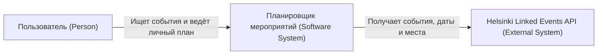
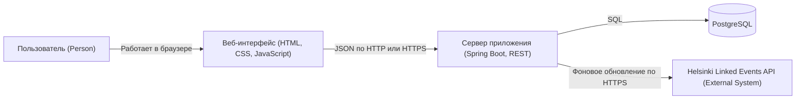
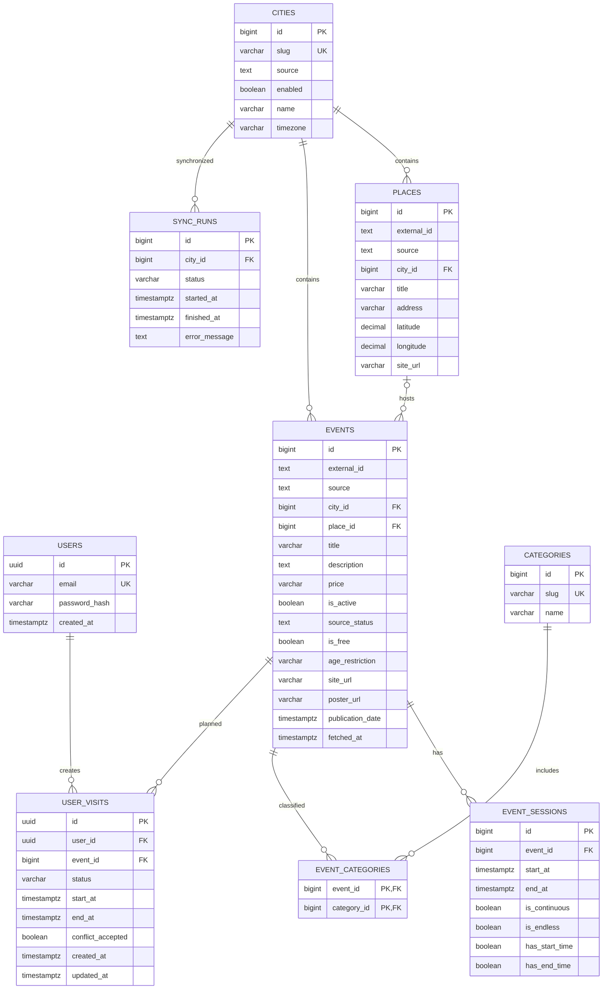

# kpo-event-planner

**Тема:** «Разработка веб-приложения для формирования персонального расписания городских мероприятий».

Учебный проект по дисциплине «Конструирование программного обеспечения».

| Часть проекта | Стек |
| --- | --- |
| Сервер | Java 17, Spring Boot 3.5.16 |
| Интерфейс | HTML, CSS, JavaScript |
| Хранение данных | PostgreSQL 17, Flyway |
| Внешний источник | Helsinki Linked Events API v1 |
| Сборка и проверки | Maven, JUnit, GitHub Actions |
| Локальный запуск | Java, локальная PostgreSQL, PowerShell |

Репозиторий: [Daniil-drom/kpo-event-planner](https://github.com/Daniil-drom/kpo-event-planner).
Отчёт о переходе на новый источник: [Helsinki Linked Events](docs/HELSINKI_MIGRATION.md).

## Этап 3. Разработка архитектуры и детальное проектирование

Ниже приведены архитектура целевой версии и состояние её реализации по коду проекта.
По мере выполнения задач соответствующие пункты переносятся в список реализованных.

### Статус реализации

#### Реализовано

- Сервер Spring Boot и REST API списка городов, категорий, каталога и карточки мероприятия.
- Схема PostgreSQL из девяти таблиц, связи, индексы и миграции Flyway; активный город Хельсинки и сохранение старых данных миграцией V3.
- Клиент Helsinki Linked Events с последовательной загрузкой страниц, категорий, мест и сеансов.
- Импорт в транзакции: обновление по внешнему ID без дубликатов; откат при ошибке сохранения.
- Фоновое обновление каталога мероприятий по городам, запись результата в `sync_runs` и сохранение прежнего каталога при сбое источника.
- Интерфейс каталога: город, категория, даты, бесплатность, страницы, карточка события и ссылка на первоисточник.
- Отображение времени в часовом поясе города; состояния загрузки, ошибки и пустого результата.
- Логирование HTTP-запросов в STDOUT без тела запроса, query string и cookie.
- Модульные и интеграционные тесты каркаса, импорта и каталога.
- Скрипты подготовки отдельных локальных БД, запуска и тестирования через PowerShell; конфигурация GitHub Actions.

#### Предстоит реализовать

- Регистрация, вход, выход, сессионная авторизация и хеширование паролей.
- Личный план: добавление, просмотр, изменение и удаление посещений; проверка владельца записи.
- Статусы «Хочу посетить», «Запланировано», «Посещено» и проверка введённого времени.
- Поиск пересечений личных посещений и явное подтверждение сохранения с конфликтом.
- Время последнего обновления и предупреждение об устаревших данных; отдельное сообщение при неудачной первой загрузке.
- Повторные запросы при сетевых ошибках и HTTP 5xx, обработка `Retry-After` и пауза между запросами к Helsinki Linked Events.
- Тесты авторизации, доступа и бизнес-правил; сквозной сценарий личного планирования.
- Подключение дополнительных городов и источников.
- Проверка полного локального запуска в Windows и CI этой версии; нагрузочная проверка целевых задержек.

### 3.1. Архитектурный подход

Выбран **модульный монолит**. Один сервер Spring Boot предоставляет REST API,
выполняет бизнес-логику и раздаёт статические файлы HTML, CSS и JavaScript.
Каталог мероприятий, пользователи и личные планы хранятся в PostgreSQL.
Фоновый планировщик внутри приложения последовательно обновляет каталог из Helsinki Linked Events.

Одна кодовая база и один сервер приложения упрощают разработку и развёртывание.
Возможность масштабирования описана в разделе 3.9.

В текущей версии каталог работает для Хельсинки (`helsinki`, `Europe/Helsinki`).
Это UTC+2 зимой и UTC+3 летом. Другие города не выдаются за данные этого источника.

Моменты времени хранятся в полях `timestamptz` и передаются через API в UTC.
При отображении применяется часовой пояс города мероприятия.

Spring Boot и PostgreSQL запускаются локально отдельными процессами;
интерфейс доступен по `http://localhost:8080`. Веб-интерфейс раздаётся самим Spring Boot.
HTTPS и несколько серверных экземпляров относятся к проекту публичного развёртывания.

#### Локальный запуск

Нужны JDK с поддержкой сборки под Java 17, Maven и работающая PostgreSQL 17.
Базы `event_planner` и `event_planner_test` один раз создаются через `psql` скриптом
`scripts/create-local-databases.sql`. Подготовка PostgreSQL из `pgsql.zip`, пароли и команды:
[инструкция для Windows](docs/LOCAL_POSTGRESQL.md).

Из корня проекта:

```powershell
# Запуск приложения
powershell -NoProfile -ExecutionPolicy Bypass -File .\scripts\run-local.ps1

# Модульные и интеграционные тесты с отдельной БД
powershell -NoProfile -ExecutionPolicy Bypass -File .\scripts\run-local.ps1 -Test
```

### 3.2. Расчёт нагрузки

#### Read/Write

| Показатель | Расчёт | Результат |
| --- | ---: | ---: |
| Чтения в сутки | 10 000 × 20 | 200 000 |
| Записи в сутки | 10 000 × 2 | 20 000 |
| Все операции в сутки | 200 000 + 20 000 | 220 000 |
| Read/Write | 200 000 : 20 000 | 10 : 1 |
| Доля чтений | 200 000 / 220 000 | 90,9% |
| Доля записей | 20 000 / 220 000 | 9,1% |
| Средняя нагрузка | 220 000 / 86 400 | 2,55 запроса/с |
| Пиковая нагрузка | 2,55 × 10 | около 26 запросов/с |

В расчётной точке пика получается около 23 запросов чтения и 3 запросов записи
в секунду. В расчёт не входят статические файлы, вход и фоновые запросы Helsinki Linked Events;
фактическая производительность проверяется нагрузочным тестом.

#### Сетевой трафик

Для расчёта приняты усреднённые значения:

- запрос чтения –  1 КБ;
- ответ на чтение –  25 КБ;
- запрос изменения –  2 КБ;
- ответ на изменение –  2 КБ;
- изображения не входят в оценку трафика сервера: в текущем интерфейсе они не загружаются; поле URL предусмотрено схемой БД.

| Трафик | Расчёт | Результат |
| --- | ---: | ---: |
| Чтения в сутки | 200 000 × (1 + 25) КБ | 5,20 ГБ |
| Записи в сутки | 20 000 × (2 + 2) КБ | 0,08 ГБ |
| Всего в сутки | 5,20 + 0,08 | 5,28 ГБ |
| Всего за год | 5,28 × 365 | около 1,93 ТБ |
| Всего за 6 лет | 1,93 × 6 | около 11,56 ТБ |

По принятым размерам сообщений пиковая передача динамических данных составляет
примерно 0,61 МБ/с, или 4,9 Мбит/с. Ориентир с двукратным запасом – 10 Мбит/с
без учёта статических файлов и служебного трафика.


### 3.3. C4: контекст системы



Пользователь работает только с приложением.
Прямые обращения браузера к API Helsinki Linked Events не выполняются.
Ссылка на конкретную страницу первоисточника сохраняется
и показывается в карточке мероприятия.

### 3.4. C4: контейнеры системы



Диаграмма показывает логические контейнеры C4. При локальном запуске интерфейс
работает в браузере, сервер приложения – в процессе Java, база данных – на сервере
PostgreSQL. Статические файлы раздаёт Spring Boot.

| Контейнер | Ответственность целевой версии |
| --- | --- |
| Web-интерфейс | Каталог, фильтры, карточка события, формы входа и личный план |
| Spring Boot | REST API, авторизация, бизнес-правила, проверка пересечений и синхронизация Helsinki Linked Events |
| PostgreSQL | Пользователи, события, сеансы, категории, места, личные планы и результаты синхронизации |

### 3.5. Контракт с Helsinki Linked Events

Сервер обращается к `https://api.hel.fi/linkedevents/v1/event/` без ключа API.
Параметры: `format=json`, `division=helsinki`, `include=location,keywords`,
`super_event_type=none`, `sort=last_modified_time,start_time,name`, `page_size=100`, `page=1…`.
Окно `start`/`end` фиксируется на весь обход: текущий момент и следующие 90 дней.
Ответ содержит массив `data` и пагинацию `meta.next`; внешняя ссылка `next` не выполняется.
Пересекающиеся страницы объединяются по ID; зацикливание без новых ID завершает загрузку ошибкой.

Первая загрузка начинается через 5 секунд, следующая – через час после завершения.
До 200 страниц загружаются последовательно, затем сохраняются одной транзакцией.
Тайм-аут соединения – 10 с, чтения – 60 с. Неполная или ошибочная загрузка
сохраняет прежний каталог. Результат, включая HTTP-код ошибки, попадает в `sync_runs`.

Строковые ID сохраняются вместе с `source=linked_events`. Повторный импорт
обновляет записи без изменения внутренних ID. Места и категории извлекаются
из раскрытых `location` и `keywords`; отдельный запрос на каждую запись не нужен.
Языки выбираются в порядке `ru → en → fi → sv`, HTML преобразуется в обычный текст.
Цены берутся из `offers`, неизвестная стоимость остаётся неизвестной. При наличии
бесплатного предложения событие доступно через фильтр «Только бесплатно».
Время хранится в UTC и отображается в `Europe/Helsinki` с учётом летнего времени.
Если источник указал только дату, интерфейс не добавляет к ней время; фильтры
используют границы местного дня.

Родительские серии, отменённые и отложенные события не включаются в каталог.
После успешной загрузки исчезнувшие записи становятся неактивными, но сохраняются
вместе с личными планами. Ссылка ведёт на `info_url` организатора, при её отсутствии 
на карточку `tapahtumat.hel.fi`. Изображения не импортируются.

Настройки окружения: `LINKED_EVENTS_BASE_URL`, `LINKED_EVENTS_SYNC_ENABLED`,
`LINKED_EVENTS_SYNC_DELAY_MS`, `LINKED_EVENTS_HORIZON_DAYS`, `LINKED_EVENTS_MAX_PAGES`.
Миграция V3 сохраняет данные KudaGo, переводит внешние ID в текст и отключает старые
города в каталоге. V1/V2 не изменяются; удалять БД или запускать Flyway repair не нужно.

### 3.6. Внутренний REST API

| Метод и путь | Назначение | Доступ целевой версии | Статус реализации |
| --- | --- | --- | --- |
| `GET /api/cities` | Список городов | Все | Реализовано |
| `GET /api/categories` | Категории событий | Все | Реализовано |
| `GET /api/events` | Каталог с фильтрами и пагинацией | Все | Реализовано |
| `GET /api/events/{id}` | Карточка мероприятия | Все | Реализовано |
| `POST /api/auth/register` | Регистрация, `201 Created` | Все | Запланировано |
| `POST /api/auth/login` | Вход и создание сессии, `200 OK` | Все | Запланировано |
| `POST /api/auth/logout` | Выход, `204 No Content` | Пользователь | Запланировано |
| `GET /api/auth/me` | Текущий пользователь | Пользователь | Запланировано |
| `GET /api/visits` | Личный план | Пользователь | Запланировано |
| `POST /api/visits` | Добавление посещения, `201 Created` | Пользователь | Запланировано |
| `PATCH /api/visits/{id}` | Изменение времени или статуса | Владелец записи | Запланировано |
| `DELETE /api/visits/{id}` | Удаление, `204 No Content` | Владелец записи | Запланировано |

Реализованные GET-методы возвращают `200 OK`. Фильтры каталога: `city`, `dateFrom`, `dateTo`, `category`,
`free`, `page`, `size`. Даты передаются как `YYYY-MM-DD` и включают оба выбранных дня в часовом поясе города.
По умолчанию: `city=helsinki`, `page=0`, `size=12`; размер страницы – от 1 до 100.
Без периода выдаются не завершившиеся события и события без определённых дат.
Некорректные параметры дают `400`, отсутствующая карточка – `404`.

Основные структуры JSON:

| Данные | Поля | Состояние |
| --- | --- | --- |
| Город | `id`, `slug`, `name`, `timezone` | Реализовано |
| Категория | `slug`, `name` | Реализовано |
| Событие в списке | `id`, `title`, `price`, `isFree`, `siteUrl`, `city`, `timezone`, `place`, `address`, `nextSession` | Реализовано |
| Карточка | Поля списка, `description`, `ageRestriction`, `sessions`, `categories` | Реализовано |
| Сеанс карточки | `startAt`, `endAt`, `isEndless` | Реализовано |
| Страница каталога | `items`, `page`, `size`, `totalItems`, `totalPages` | Реализовано |
| Дополнение карточки | `fetchedAt`; `posterUrl` при добавлении изображений | Запланировано |
| Регистрация и вход | `email`, `password`; в ответе данные пользователя без пароля | Запланировано |
| Создание посещения | `eventId`, `status`, `startAt`, `endAt`, `acceptConflict` | Запланировано |
| Изменение посещения | Изменяемые `status`, `startAt`, `endAt`, `acceptConflict` | Запланировано |
| Сохранённое посещение | `id`, `event`, `status`, `startAt`, `endAt`, `conflictAccepted`, `createdAt`, `updatedAt` | Запланировано |

Проект авторизации: пароль хранится в виде стойкого хеша; вход создаёт серверную HTTP-сессию. Cookie – `HttpOnly`,
`SameSite=Lax`, для публичного HTTPS также `Secure`. Сервер определяет пользователя по сессии и проверяет владельца
каждой записи плана; чужой `userId` из запроса не используется для выдачи доступа.

Проект личного плана: `WANT_TO_VISIT` допускает отсутствие времени; для `PLANNED` обязательны `startAt` и `endAt`,
окончание позже начала. Времена передаются в ISO 8601 со смещением.
Пересечение есть при `startA < endB && startB < endA`; сравниваются только запланированные посещения
текущего пользователя, редактируемая запись исключается. Соседние интервалы не конфликтуют.
При конфликте – `409 Conflict` со списком пересечений; сохранение допускается после явного подтверждения.
Ошибки доступа `401`/`403` и этот сценарий ещё не реализованы.

Целевые задержки при базовой нагрузке:

| Операция | Требование |
| --- | --- |
| Каталог, карточка, личный план, создание и изменение посещения | p95 ≤ 1 с |
| Регистрация и вход | p95 ≤ 1,5 с с учётом хеширования пароля |
| Фоновый запрос Helsinki Linked Events | Соединение 10 с, чтение 60 с; в пользовательский запрос не входит |

Значения p95 – цели для последующей нагрузочной проверки.

### 3.7. Проектирование базы данных



Основные индексы:

| Таблица | Индекс | Причина |
| --- | --- | --- |
| `users` | `UNIQUE (email)` | Вход и запрет дублирующихся учётных записей |
| `cities` | `UNIQUE (slug)` | Поиск города по идентификатору API |
| `places` | `UNIQUE (source, external_id)` | Обновление места без дубликатов |
| `events` | `UNIQUE (source, external_id)` | Идемпотентная синхронизация |
| `events` | `(city_id, is_free, publication_date DESC)` | Базовые фильтры каталога |
| `event_sessions` | `(start_at, end_at, event_id)` | Отбор мероприятий по периоду |
| `event_categories` | `(category_id, event_id)` | Фильтр по категории |
| `user_visits` | `(user_id, status, start_at)` | Личный план по статусу и времени |
| `user_visits` | `(user_id, start_at, end_at)` | Поиск пересечений пользователя |
| `sync_runs` | `(city_id, started_at DESC)` | Последний результат обновления города |

Фильтр дат использует границы дней в часовом поясе города: начало сеанса раньше начала дня после `dateTo`,
окончание – не раньше начала `dateFrom`. Учитываются признаки неограниченных периодов и точечные сеансы.

Таблицы `users` и `user_visits` созданы, операции приложения над пользователями и посещениями в реализовации.
В `user_visits` имеются ограничения статуса и интервала;
удаление события со связанным посещением запрещено внешним ключом.

Пароли, cookie и содержимое сессий не включаются в журнал HTTP-запросов.
Повторные обращения и паузы выше – проектные настройки приложения.


Каталог событий одинаков для всех пользователей, поэтому он хорошо кэшируется. Личные планы кэшируются только с ключом пользователя либо читаются из PostgreSQL. Источником истины остаётся PostgreSQL; потеря Redis не приводит к потере данных.

Документация внешнего источника: [Helsinki Linked Events](https://github.com/City-of-Helsinki/linkedevents).
